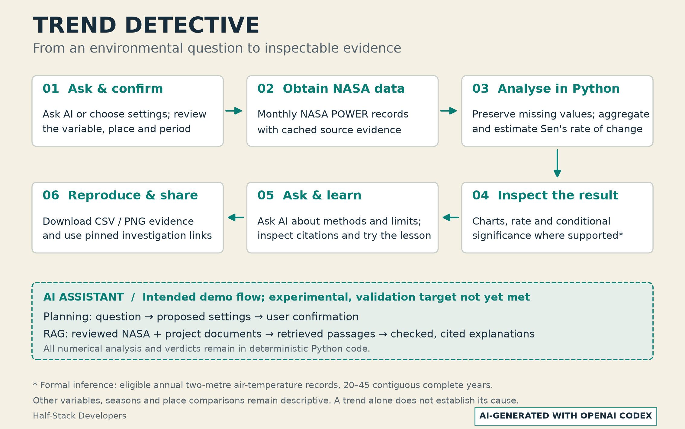

# Trend Detective

An educational Earth-science investigation app by **Half-Stack Developers** for
[Be an Earth System Trend Detective!](https://www.spaceappschallenge.org/2026/challenges/earth-system-trend-detective/).

Choose a location, variable and period; inspect NASA POWER time series, estimate
change and examine statistical evidence where supported. Explore a case file,
compare places, inspect sources, try the interpretation lesson and download evidence.



## Start here

| Resource | What it contains |
| --- | --- |
| [Submission guide](docs/submission.md) | Copy-ready fields, demo outline, requirement/judging audit and final checklist |
| [Walkthroughs](docs/walkthroughs.md) | Saved investigations and interpretation prompts |
| [Technical specification](docs/technical-spec.md) | Architecture, data contracts, methods and inference scope |
| [Verification](docs/verification.md) | Observed software checks and their limits |
| [AI evaluation](docs/evaluation-results.md) | Actual model results, failed gates and retained evidence |
| [AI disclosure](docs/ai-disclosure.md) | Team decisions, development assistance, runtime AI and contributor history |
| [Deployment](docs/deployment.md) | Public hosting, persistent state and operational checks |

The source is public. No public hosted app or final demo/presentation URL has been
provided in this repository. A local demo is not a public deployment.

## Run locally

Tested on Windows with **Python 3.14.5** and **Node 22.23.5**. The backend package
allows Python >=3.12; the lockfile pins dependencies. Install uv and Node first.

From the repository root, create a local environment file only if one does not exist:

```powershell
if (!(Test-Path .env)) { Copy-Item .env.example .env }
cd backend
uv sync --locked
uv run --env-file ../.env uvicorn app.main:app --reload
```

In a second terminal, from the repository root:

```powershell
cd frontend
npm ci
npm run dev
```

Open **http://localhost:5173**. Manual controls and the four cached examples work
without an AI key or a live NASA connection. New locations/quantities require NASA
POWER. After `npm run build` in `frontend/`, the backend also serves the built app
at http://localhost:8000.

### Configure the AI assistant

The team selected an AI-enabled demo template. `.env.example` selects OpenAI and
sets the planner, discovery and explanation switches to `true`. These are activation
settings, not a claim that an evaluation target was passed. Without loaded
environment settings, the main AI switch defaults off. Existing `.env` files are
not overwritten by Git or by the command above.

To use AI, set your own `OPENAI_API_KEY`, retain the configured model/pricing and
upload the reviewed corpus to a vector store accessible to that key. Set the
resulting `RAG_VECTOR_STORE_ID` and `RAG_CORPUS_VERSION`; the version must match
`backend/data/corpus/manifest.json`. No local model download is required. A teammate
cannot assume that their key can access another person's store.

From `backend/`, an owner can upload the existing corpus after reviewing the
payload and provider storage implications:

```powershell
uv run --env-file ../.env python -m scripts.upload_corpus --max-bytes 1000000
```

This sends the corpus to OpenAI and can incur usage/storage charges. It is not
part of normal app startup. See [deployment and retrieval setup](docs/deployment.md).

Keep the root `state/` directory across restarts. The sample declares durable
budget storage and uses a **USD 1 daily reservation limit**; a hosted deployment
must mount persistent state. Credentials belong only in the backend environment,
never Git or frontend variables. Restart the backend after editing `.env`.

Check http://localhost:8000/api/capabilities. AI planning, discovery and explanations
are available only when their configuration conditions are met. Checking readiness
does not call a model or verify answer quality. Manual controls remain available.

### AI scope and limitations

Natural-language planning proposes settings for user confirmation. RAG retrieves
reviewed NASA documentation and project method notes for qualitative explanations.
All numerical analysis and verdicts remain in deterministic Python code.

The assistant is **experimental**. A planner/discovery follow-up passed 50/50
automated cases; the later source-checked RAG sample passed 31/40 combined checks,
below its 36/40 target. The paired no-retrieval condition passed 10/40 under the same
citation requirements. These are separate, agent-authored samples, not independent
human validation or a general accuracy guarantee. The team chose activation despite
the unmet target. See the [full evidence](docs/evaluation-results.md).

## Scientific scope and reproducibility

- NASA POWER monthly records drive charts and rate estimates. Gridded estimates
  represent an area, not an exact observation at a street address.
- Python preserves missing values and computes calendar-day-weighted summaries.
  Missing observations are not replaced by zero.
- Sen's slope estimates change per decade. Formal significance is limited to
  eligible annual two-metre air-temperature records with 20–45 contiguous complete
  years, under the documented Monte Carlo Mann–Kendall inference policy.
- Other variables, seasonal analyses, maps and place comparisons are descriptive.
  Comparisons use common complete years. Unsupported p-values/intervals are withheld.
- The [simulation study](research/inference-plan.md) and its confirmation results
  check stated assumptions; they do not establish universal climate calibration.
- A trend alone does not establish causation or predict the future. Non-significance
  does not prove no change. Educational impact has not been measured in a user study.

The committed `backend/data/cache.sqlite` is a read-only seed copied into local
state on first startup. New downloads retain exact response bytes; legacy seed
records lacking original response bytes are labelled as normalized evidence.
Retain `state/snapshots` and operational storage for pinned investigation replay.
Exact investigation hashes have not been demonstrated identical across platforms;
local pinned replay was verified. See [verification](docs/verification.md).

## Development checks

Run in `backend/`:

```powershell
uv run pytest
uv run ruff check .
uv run ruff format --check .
uv run python -m scripts.generate_types --check
```

Run in `frontend/`:

```powershell
npm run test
npm run lint
npm run format:check
npm run build
```

Tests use saved data and fake providers; they require no API credits. Scientific
study scripts, corpus rebuilds and real-provider evaluations are separate owner-run
operations, not startup requirements. Retained study and evaluation artifacts must
not be treated as measured student impact or a successful public deployment.

## Deployment

The backend can serve the API and built frontend in one container:

```powershell
docker compose up --build
```

Compose loads the root `.env` and mounts persistent state. Public hosting needs a
public HTTPS address, server-side secrets and deployment checks. A local demo or
recording does not expose your computer to judges. Follow the
[deployment guide](docs/deployment.md); do not upload `.env` to share AI access.

## NASA data and credits

NASA POWER monthly values provide the time series behind charts, rates and eligible
significance results. T2M is two-metre air temperature from MERRA-2 reanalysis;
it describes a grid cell, not a city weather station. Additional catalogue variables
are exploratory/descriptive: snow, sea ice, surface pressure, water vapour and the
strongest wind also come from MERRA-2, and haze is CERES SYN1deg aerosol optical depth
(MODIS aerosol assimilated by the MATCH model) from 2001, not the MODIS Aqua product in Giovanni.
[Clouds and aerosols sources](https://power.larc.nasa.gov/docs/methodology/data/sources_clds_aerosols/). Source documentation:
[NASA POWER](https://power.larc.nasa.gov/),
[processing and quantity semantics](https://power.larc.nasa.gov/docs/methodology/data/processing/),
[radiation sources and continuity](https://power.larc.nasa.gov/docs/methodology/data/sources_fluxes/).

These data were obtained from the NASA Langley Research Center (LaRC) POWER Project
funded through the NASA Earth Science/Applied Science Program. Evidence records
show API version, access date, retained query/source metadata and snapshot checksums.
The shipped legacy examples report API v2.10.0, accessed 2026-11-13.

Places: GeoNames cities15000 and countryInfo, downloaded 2026-11-15, CC BY 4.0; the build
script retains cities of at least 100,000 people and every capital (marked as one), with
selected fields. A country's name finds its capital. Analysis remains useful without map tiles.

Globe tiles: [OpenFreeMap](https://openfreemap.org/), in the [OpenMapTiles](https://www.openmaptiles.org/)
schema (© OpenMapTiles), with data © [OpenStreetMap](https://www.openstreetmap.org/copyright)
contributors under the ODbL. The globe shows the credit "OpenFreeMap © OpenMapTiles Data
from OpenStreetMap" at all times. The browser loads the tiles, the relief image and the label
fonts from `tiles.openfreemap.org`; no key or account is needed. The relief image is
[Natural Earth](https://www.naturalearthdata.com/) II with shaded relief (public domain), and
the globe's label font is Noto Sans (SIL Open Font License), both served by OpenFreeMap.

The page's three typefaces are in `frontend/src/fonts/`, as WOFF2 files of their Latin and Latin Extended subsets, taken from [Fontsource](https://fontsource.org/) 5.3.0 on 14 November 2026. Each is under the [SIL Open Font License 1.1](https://openfontlicense.org/); the licence texts lie beside the files.

- [Bodoni Moda](https://github.com/indestructible-type/Bodoni), © 2020 The Bodoni Moda Project Authors: the app's name, the key figure and the titles of cases.
- [Libre Baskerville](https://github.com/impallari/Libre-Baskerville), © 2012 The Libre Baskerville Project Authors: all running text.
- [Courier Prime](https://github.com/quoteunquoteapps/CourierPrime), © 2015 The Courier Prime Project Authors: typed labels, such as case numbers, stamps and the tags on the globe.

## AI assistance

OpenAI Codex and Claude Code assisted with substantial code, research, tests,
documentation and interface work. Codex also prepared the submission diagrams,
which carry visible AI-generation watermarks. Development assistance is separate
from the optional OpenAI-powered in-app assistant. The
[AI disclosure](docs/ai-disclosure.md) identifies team decisions, actual checks,
limitations and historical contributor reports. AI-assisted commits retain
co-author metadata. The team remains responsible for the final submission.

The team has not selected a project licence. Third-party data, fonts, map assets
and dependencies retain their own terms; public source access does not itself
grant a new licence.
