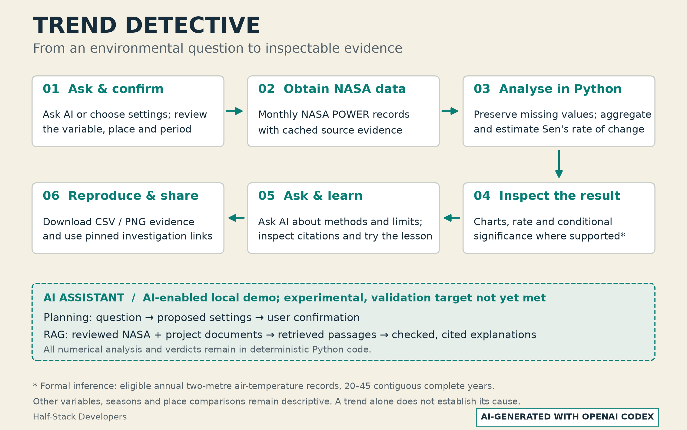
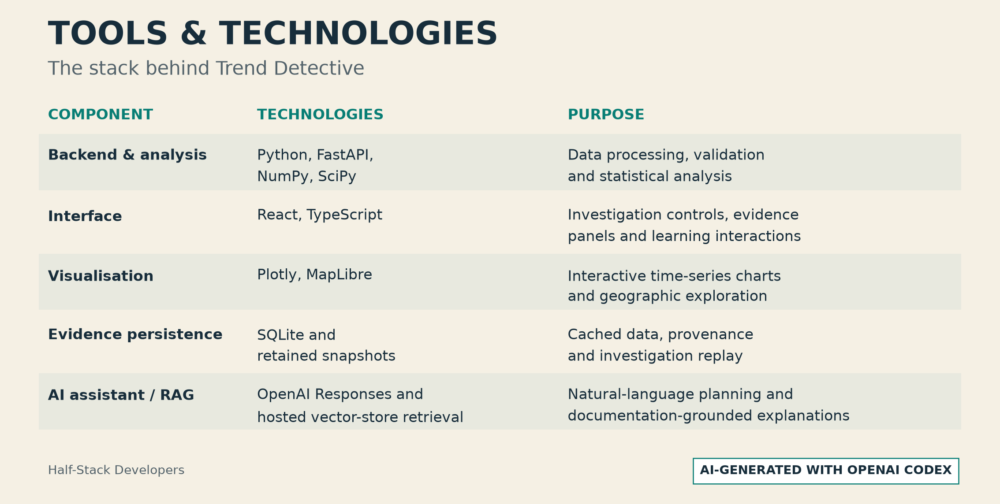

# Submission guide

Prepared for **Half-Stack Developers**, 15 November 2026 (SGT).
This file consolidates copy-ready text and remaining submission actions. It is
not confirmation that the official form has been submitted.

## Project name

Half-Stack Developers — Trend Detective

## Project summary

Half-Stack Developers presents Trend Detective, an educational application that helps students and the public investigate environmental change using NASA Earth science data. Users select a location, variable and time period to explore interactive charts, compare places and estimate rates of change.

Powered by NASA POWER data, each investigation becomes an inspectable case file containing visualisations, source information, limitations and downloadable evidence. For eligible annual temperature records, the app evaluates statistical significance under documented assumptions. Other variables, seasonal analyses and comparisons remain descriptive.

Our detective-inspired interface and interpretation lesson help users distinguish a trend's size from the strength of its evidence and recognise that historical trends alone cannot establish causation or predict the future.

An experimental OpenAI-powered RAG assistant supports natural-language investigation planning and explanations grounded in NASA documentation and reviewed project methodology. Users confirm proposed settings, and numerical results remain in Python.

Our goal is to make environmental evidence accessible, transparent and reproducible, helping people investigate our changing planet.

## Project details

The following five sections are the project-details field. NASA source links and
development-AI disclosure have dedicated form fields below. The diagrams are
watermarked generated graphics, not application screenshots.

## 1. What Trend Detective does

Is a change in the environment a lasting trend, or could it reflect ordinary variability? Half-Stack Developers built Trend Detective to help students and the public investigate this question using NASA Earth science data.

The application connects variable selection, regional data access, time-series visualisation and statistical interpretation in one detective-inspired experience. Each investigation becomes a case file containing a chart, estimated rate of change, applicable statistical evidence, source information and downloadable values. Users can explore temperature, precipitation, humidity, wind and soil wetness, compare places and inspect the evidence behind the result.

Our primary audience is high-school and college students and interested members of the public. The intended benefit is a more accessible way to investigate environmental claims while learning what data can—and cannot—support.

## 2. How it works

1. **Ask and confirm.** In the intended AI-enabled demo, ask the assistant to propose a location, supported variable, period and annual or seasonal view, then review and confirm the settings. Manual settings and saved examples remain available.
2. **Obtain NASA data.** The backend obtains monthly NASA POWER records through a dedicated source adapter and cache. Evidence identifies the requested location and the actual geographic grid cell.
3. **Analyse consistently.** Python preserves missing data, creates calendar-day-weighted summaries and estimates Sen's rate of change. Missing months are not replaced by zero; incomplete years remain explicit gaps.
4. **Inspect the conclusion.** Interactive charts show historical values and a fitted trend. Formal significance is reported only within the supported annual temperature scope; other analyses remain descriptive.
5. **Ask and learn.** In the intended AI-enabled demo, ask the assistant about the dataset, methods and limitations, then inspect its cited passages. Compare places over common complete years and complete the interpretation lesson.
6. **Reproduce and share.** Download CSV values and PNG charts, inspect retained evidence and share a pinned investigation link. Replaying a pinned case depends on the same application retaining its required snapshots.

## 3. Key technical and creative contributions

### An evidence-centred detective experience

Trend Detective brings analysis, explanation and verification into one case file. A result is accompanied by its variable definition, units, spatial context, method and limitations. Users can follow the evidence rather than rely on an unexplained headline.

The interpretation lesson reinforces three distinctions: the size of a trend is different from statistical significance; non-significance does not prove no change; and a trend alone cannot establish its cause or predict the future.

### Statistical inference with an explicit scope

Sen's slope provides a rate estimate, expressed in the variable's units per decade. Formal inference is restricted to eligible annual two-metre air-temperature records with 20–45 contiguous complete years under our documented Mann–Kendall-based, Monte Carlo inference policy. Simulation checks examine behaviour within specified serial-dependence assumptions; they do not establish universal climate calibration.

Other variables, seasonal analyses, maps and place comparisons remain descriptive. Unsupported p-values and confidence intervals are withheld. All quantitative results and verdicts come from deterministic Python code.

### Optional documentation-grounded AI

We implemented and evaluated an OpenAI-powered retrieval-augmented generation pipeline with two roles: translating questions into proposed investigation settings for user confirmation, and producing qualitative explanations supported by retrieved documentation.

The reviewed corpus contains 173 text sections from 13 NASA sources and 10 project method/variable notes. Retrieved passages supply context about datasets, methods and limitations. Responses are checked for allowed result references, citations and consistency with the investigation. The LLM does not calculate statistics or replace canonical verdicts.

The team enabled the assistant in its local demo and selected an AI-enabled environment template. It remains experimental: explanation quality has not met the documented release target. The diagram describes the intended interaction, while the manual investigation remains available independently.

## 4. Tools and technologies

| Component | Technology | Purpose |
| --- | --- | --- |
| Analysis and backend | Python, FastAPI, NumPy, SciPy | Validated inputs, data processing and deterministic analysis |
| Interface | React, TypeScript | Investigation settings, evidence panels and learning interactions |
| Visualisation | Plotly, MapLibre | Interactive time-series charts and geographic exploration |
| Evidence persistence | SQLite and retained snapshots | Cached data, provenance and investigation replay |
| Optional AI | OpenAI Responses and hosted vector-store retrieval | Natural-language planning and documentation-grounded explanations |

## 5. Intended impact and future development

Trend Detective aims to help learners move from seeing a graph to asking better questions: What is changing? Over which years? What does this variable represent? How strong is the evidence? What remains unknown?

Next steps are improving source-grounded explanations, completing teammate review, observing intended users and verifying a public deployment. User testing has not been conducted, so educational gains remain an intended outcome rather than a measured result. The core prototype can run locally without a downloaded language model; the optional AI uses OpenAI-hosted services.

## NASA Data field

| Link text | Full URL | Contribution |
| --- | --- | --- |
| NASA POWER — Monthly Environmental Data | https://power.larc.nasa.gov/docs/services/api/temporal/monthly/ | Numerical records behind charts, rates and eligible significance results |
| NASA POWER — Methodology and Source Documentation | https://power.larc.nasa.gov/docs/methodology/ | Dataset definitions, processing context and reviewed RAG references |
| NASA MERRA-2 — Underlying Temperature Reanalysis | https://gmao.gsfc.nasa.gov/gmao-products/merra-2/ | Context for the reanalysis underlying the primary temperature variable; accessed through POWER |

The corpus's complete NASA document list is in
[its manifest](../backend/data/corpus/manifest.json). Those additional documentation
pages are reference resources, not separate numerical datasets downloaded by the app.
Data attribution: these data were obtained from the NASA Langley Research Center
POWER Project. This independent prototype does not imply NASA endorsement.

## Space Agency Partner & Other Data field

| Link text | Full URL | Actual use |
| --- | --- | --- |
| GeoNames — City and Country Data | https://download.geonames.org/export/dump/ | Place lookup and country-capital matching |
| OpenFreeMap — Basemap Tiles | https://openfreemap.org/ | Globe basemap tile service |
| OpenStreetMap — Underlying Map Data | https://www.openstreetmap.org/copyright | Map data served through the basemap |
| Natural Earth — Globe Relief Imagery | https://www.naturalearthdata.com/ | Relief background served through OpenFreeMap |

Software, font and map-schema credits remain in the [README](../README.md#nasa-data-and-credits).
Do not list researched but unused datasets as integrated data sources.

## Super Intelligence / AI use field

Select applicable categories for research/information gathering, coding/debugging,
building AI/ML into the project, text assistance and generated diagrams according
to the options actually displayed. The detailed
[AI-use statement](ai-disclosure.md) follows the team's decisions / tool use /
verification structure. Keep the visible AI watermarks on uploaded graphics and
AI disclosure in the repository; the form says its SI-use response is not shown to judges.
Do not use NASA logos, flags or mission identifiers in generated content.

## Demo: 30-second video or 7-slide presentation

The supplied organizer message permits either format. A public hosted API or
downloaded local model is not required for the recorded prototype demonstration.

The finished demo is [available in the repository](../demo-video/README.md), with
[seven subtitle cues](../demo-video/trend-detective-demo.srt). Its movie/video
duration is 29 seconds and audio track approximately 29.02 seconds. Its metadata
discloses AI video and voice-over generation; representative frames were checked
for the visible watermark, and the full video/audio decoded without errors.
The recording cuts provider waits and does not establish response latency
or general assistant accuracy. A final listen/watch by a teammate remains required.

**Public demo URL to paste into the form:**

https://github.com/ychengchong/NASA-Space-Apps-Challenge-2026/blob/df756f87e7a495295b5cc49867e5b4f11f02378a/demo-video/trend-detective-demo.mp4

If an inline player is unavailable, use View raw / Download raw file, or the
[direct MP4](https://raw.githubusercontent.com/ychengchong/NASA-Space-Apps-Challenge-2026/df756f87e7a495295b5cc49867e5b4f11f02378a/demo-video/trend-detective-demo.mp4).

| Time | Suggested video sequence |
| --- | --- |
| 0–5 seconds | Name the problem and open a saved investigation |
| 5–12 seconds | Show the location, variable, dates and historical chart |
| 12–20 seconds | Show the actual rate, applicable statistical evidence and source/grid context |
| 20–27 seconds | Show a download or interpretation lesson; include one real AI interaction only if rehearsed and within the time limit |
| 27–30 seconds | Finish on the project name and accessible project link |

Use the application's actual result; never insert a desired rate or verdict.
If showing AI, record its real behaviour and label it experimental. Do not count
a capabilities check or a templated verdict as a demonstrated generated answer.

Alternative seven-slide outline: problem/audience; question-to-evidence workflow;
actual NASA investigation; methods/limits; assistant/RAG architecture; intended
impact and prototype limits; project link, credits and next steps.

## Requirements and judging audit

This audit uses [event information](event-information.md), the
[saved challenge description](challenge-description.md), the supplied organizer
message and submission-form screenshots. The live challenge URL returned 502
during this cleanup, so its current contents were not independently reverified.

| Requirement | Repository evidence | What remains |
| --- | --- | --- |
| Meaningful use of at least one NASA dataset | POWER adapter, saved examples, charts, rates and source evidence | Enter NASA source links in the official form |
| Identify a variable and obtain regional data | Catalogue, settings, place lookup and grid context | Show one actual investigation in the demo |
| Visualise a time series and estimate change | Interactive chart and Sen's slope | Keep variable, units and period visible |
| Assess significance | Scoped annual-temperature inference and retained simulation evidence | Explain assumptions; other analyses stay descriptive |
| Project name, summary and details | Copy-ready fields above | Save and review the official form |
| Demo video or seven slides | 29-second MP4, subtitles and public links above | Teammate's final watch/listen and official form entry |
| Public final-project/supporting-material link | https://github.com/ychengchong/NASA-Space-Apps-Challenge-2026 | Merge the demo PR and check anonymous access |
| AI/resource attribution | AI-use statement, visible diagram watermarks and README credits | Retain disclosures in the final uploaded materials |
| Submission before organizer deadline | Supplied deadline: 15 November 2026, 11:59 PM SGT | Submit and observe the site's confirmation |

| Criterion (1–5) | What this prototype offers | Evidence boundary / final presentation action |
| --- | --- | --- |
| Impact | Students and the public can investigate environmental claims | Explain the audience and intended benefit; no measured learning gains are claimed |
| Creativity | Detective case files connect exploration, evidence, interpretation and sharing | Show that connected journey, rather than only a chart or chatbot |
| Validity | NASA provenance, deterministic analysis, scoped inference, tests and retained AI evaluations | Disclose experimental AI and the unmet explanation target; avoid causal/forecast claims |
| Relevance | Variable selection, regional data, time series, rates and significance in the supported scope | Demonstrate one complete eligible temperature investigation |
| Presentation | Prepared text, diagrams and a 29-second demonstration | Final watch/listen and public-link checks; submit the demo URL |

The challenge's audience guidance, variable definitions, short questions,
demonstration examples, monthly inputs, interpretation of non-significance,
hydrology-tool review and seasonality considerations are mapped in
[spec section 2](technical-spec.md#2-challenge-requirements-and-judging-evidence)
and the [resource assessment](resource-assessment.md). These considerations do not
require integrating every suggested dataset. The team deferred user testing for
this submission; it is not an organizer requirement in the supplied information.
No score, nomination, ranking or award outcome can be guaranteed.

## Final checklist

- [x] Prepare summary, project details, resource entries and watermarked diagrams.
- [x] Record development/runtime AI use and preserve scientific/evaluation evidence.
- [x] Choose the experimental AI-enabled local demo configuration.
- [x] Publish the repository cleanup at `d9b54fb`.
- [x] Commit the 29-second demo and subtitles; provide a stable public video URL above.
- [ ] Merge the demo PR and enter its URL in the official form.
- [x] Check repository/video URLs through unauthenticated HTTP requests.
- [ ] Watch and listen to the public video in a browser without signing in.
- [ ] Complete all required official form fields, resource links and SI categories.
- [ ] Verify the final recording matches the app and retains required disclosures.
- [ ] Submit before 15 November 2026, 11:59 PM SGT, and observe confirmation.

Public interactive hosting remains optional for this source/recorded-demo
submission path and is not verified. If choosing hosting, follow the
[deployment guide](deployment.md), configure server-side secrets and persistent
state, and check the public instance. Do not expose or upload the local `.env`.
